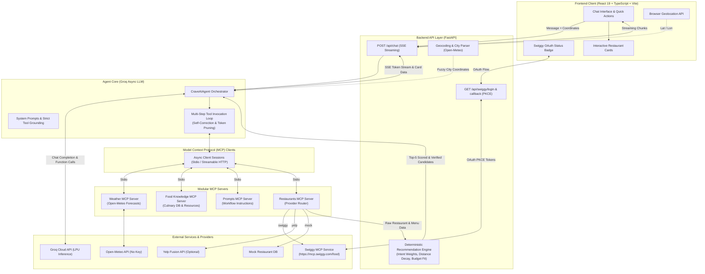

# CraveAI 🍲

> **Context-Aware Food Discovery Agent Orchestrator**  
> *Intelligent, weather-grounded food recommendations and verified restaurant discovery powered by Model Context Protocol (MCP) and Groq LLMs.*

[](https://www.python.org/)
[](https://fastapi.tiangolo.com/)
[](https://react.dev/)
[](https://www.typescriptlang.org/)
[](https://vite.dev/)
[](https://groq.com/)
[](https://modelcontextprotocol.io/)
[](https://open-meteo.com/)

---

## 📑 Table of Contents

- [Overview](#-overview)
- [Key Features](#-key-features)
- [Architecture](#-architecture)
- [Live Demo & Interface](#-live-demo--interface)
- [Tech Stack](#-tech-stack)
- [How It Works](#-how-it-works)
- [Project Structure](#-project-structure)
- [Getting Started (Windows PowerShell)](#-getting-started)
- [Environment Variables](#-environment-variables)
- [Usage Examples](#-usage-examples)
- [Testing & Quality Checks](#-testing--quality-checks)
- [Limitations & Known Constraints](#-limitations--known-constraints)
- [Roadmap](#-roadmap)
- [Contributing & Security](#-contributing--security)
- [Author & Acknowledgements](#-author--acknowledgements)

---

## 💡 Overview

Traditional food delivery applications force users to search through thousands of generic restaurant listings, guess which dishes match their current mood or local weather, and manually verify whether a dish is actually served.

**CraveAI** reimagines food discovery as an **agentic, context-aware workflow**:

1. **Context First**: Instead of asking for a keyword, CraveAI factors in live external context—such as current atmospheric weather (temperature, rain, sunshine via Open-Meteo) and real user coordinates.
2. **Culinary Grounding**: Connects to a structured Food Knowledge database to associate weather and regional cultures with authentic culinary items (e.g., comforting warm dal baati or crisp pakoras on stormy days, refreshing chaats on hot afternoons).
3. **Multi-Server MCP Architecture**: Adheres strictly to the **Model Context Protocol (MCP)**, delegating weather telemetry, culinary knowledge, workflow prompts, and restaurant retrieval to modular, independently testable MCP servers.
4. **Authoritative Menu Verification**: Interfaces with live delivery providers (Swiggy MCP via Streamable HTTP and OAuth PKCE) to inspect individual restaurant menus, categorize items (freshly prepared vs. packaged retail goods vs. sides), verify real-time dish availability, and provide direct storefront links.
5. **Deterministic Ranking Engine**: Ranks candidate restaurants using an explainable multi-factor scoring model that dynamically adapts scoring weights to the user's intent (prioritizing distance for "nearby", ratings for "best", and budget for "cheap").

---

## ✨ Key Features

### 🌦️ Weather-Aware Food Intelligence
- Fetches real-time temperature and WMO weather codes via the Open-Meteo API (no external API key required).
- Normalizes complex conditions into clear contextual buckets (`clear`, `pleasant`, `hot`, `cold`, `cloudy`, `rainy`, `stormy`).
- Bridges conditions with culinary traditions without hallucinating rain or assuming cold weather on warm, sunny days.

### 📍 Intelligent Location & Fuzzy Geocoding
- Seamlessly integrates browser geolocation coordinates.
- Includes smart city entity extraction from natural conversation queries (e.g., *"What should I eat in Ahmedabad?"*).
- Built-in fuzzy spelling correction for Indian cities using `difflib` (e.g., auto-resolving *"ahmedabaf"* to *"Ahmedabad"* with transparent confirmation).
- Retains conversational context across multi-turn dialogues when users provide location follow-ups.

### 🔌 Quad-MCP Server Ecosystem
- **Food Knowledge Server** (`mcp_servers/food_knowledge`): Static culinary taxonomy offering dish information, regional specialties, weather/mood associations, and official MCP resources (`food://cities/{city_id}`, `food://cuisines/{cuisine_id}`, `food://dishes/{dish_id}`).
- **Weather Server** (`mcp_servers/weather`): Live weather and multi-day precipitation forecasts with automatic coordinate geocoding.
- **Restaurant Server** (`mcp_servers/restaurants`): Provider-agnostic restaurant discovery supporting Swiggy (Streamable HTTP, OAuth 2.0 PKCE, menu inspection), Yelp Fusion API, and a deterministic Mock provider.
- **Prompts Server** (`mcp_servers/prompts`): Implements the official MCP Prompts specification, delivering step-by-step behavioral guidance (`rainy_day`, `city_experience`, `budget_food`) to the LLM.

### 🎯 Deterministic Recommendation & Scoring Engine
- Intermediate ranking layer between raw provider results and LLM response generation.
- **Dynamic Intent-Aware Weights**: Automatically boosts scoring dimensions based on language heuristics:
  - *"Best / Top"* &rarr; Boosts rating weight (40%) and food match (40%).
  - *"Nearby / Close"* &rarr; Boosts distance decay weight (40%).
  - *"Budget / Cheap / ₹250"* &rarr; Boosts budget tier fitting (40%).
- **Multi-Tier Candidate Sorting**: Strictly prioritizes `Confirmed Menu Matches` > `Possible Category Matches` > `Unverified Listings`, with open restaurants ranked ahead of closed outlets.

### 🔍 Menu-Item Verification & Product Disambiguation
- Performs live cross-restaurant menu queries (`search_menu`) through Swiggy MCP.
- Strictly indexes items by restaurant ID to prevent misleading cross-restaurant dish attribution.
- **Product Classification**: Differentiates freshly prepared dishes from packaged retail products (e.g., packaged chocolate waffle tubes vs. freshly baked waffles) and side snacks (e.g., waffle fries).
- Displays explicit dish availability badges (`is_available: false` rendered as `Currently Unavailable`).

### 🔗 Real Storefront Link Strategy
- Prioritizes canonical restaurant URLs when returned by provider metadata.
- Automatically builds verified Swiggy web search URLs (`{restaurant_name} {dish_name}`) for local outlets.
- Provides dish-only fallback links for outlets outside the immediate delivery radius to avoid empty search illustrations.

### ⚡ Real-Time Streaming UI (React 19 + SSE)
- Server-Sent Events (SSE) stream agent progress and thinking states directly to the chat interface.
- Rich interactive restaurant cards complete with ratings, distance in km, price tier, verified dish names, prices in ₹, and direct Swiggy links.
- Quick action suggestion chips for one-tap food discovery.
- Live Swiggy OAuth connection status badge in the application header.

---

## 🏛️ Architecture

CraveAI separates agent orchestration, deterministic scoring, tool execution, and frontend presentation into clean, decoupled tiers:



---

## 🖼️ Live Demo & Interface

The frontend provides an intuitive conversational interface with real-time feedback, status indicators, and structured dish cards.

### Interface Preview


```
┌────────────────────────────────────────────────────────────────────────┐
│ 🍲 CraveAI - Context-Aware Food Discovery          [📍 Location On]   │
│                                                    [● Swiggy Connected]│
├────────────────────────────────────────────────────────────────────────┤
│                                                                        │
│  User: What food do you recommend for today's weather?                │
│                                                                        │
│  Agent: ⚙️ Checking current weather... (Clear, 32°C)                   │
│         ⚙️ Searching food knowledge...                                 │
│                                                                        │
│  It's currently clear and warm in Ahmedabad (32°C). For sunny and      │
│  pleasant weather, refreshing street foods and light savory snacks are │
│  ideal. Here are top verified options nearby:                          │
│                                                                        │
│  ┌──────────────────────────────────────────────────────────────────┐  │
│  │ Das Khaman                                    [✓ Confirmed Match]│  │
│  │ ★ 4.4 · $ · 1.8 km · Navrangpura, Ahmedabad         [Open]       │  │
│  │ ──────────────────────────────────────────────────────────────── │  │
│  │ Verified on Menu:                                                │  │
│  │  • Nylon Khaman — ₹80 (4.5★)                                     │  │
│  │  • Sev Khamani — ₹90 (4.3★)                                      │  │
│  │ ──────────────────────────────────────────────────────────────── │  │
│  │ [Search restaurant and dish on Swiggy ↗]   [Search dish only ↗]  │  │
│  └──────────────────────────────────────────────────────────────────┘  │
│                                                                        │
├────────────────────────────────────────────────────────────────────────┤
│ [Find food nearby] [Something budget-friendly] [Food for today's weather]│
│ [Ask CraveAI anything about food...                              ] [ ➤ ]│
└────────────────────────────────────────────────────────────────────────┘
```

> **Note:** Screenshots can be added to the repository under `docs/screenshots/` and referenced directly here.

---

## 🛠️ Tech Stack

| Category | Technology | Purpose & Details |
| :--- | :--- | :--- |
| **Frontend Framework** | **React 19** (`react@^19.2.8`) | Modern component architecture, concurrent rendering |
| **Language** | **TypeScript** (`~6.0.2`) | Strict type safety across messages, restaurants, and auth |
| **Build Tool** | **Vite** (`^8.3.0`) | Lightning-fast HMR and optimized production bundles |
| **Styling** | **Vanilla CSS Design System** | Custom dark theme, glassmorphism, responsive CSS variables |
| **Markdown Rendering** | **React Markdown** (`^10.1.0`) + **Remark GFM** | Streaming assistant responses with formatted links and lists |
| **Linter** | **Oxlint** (`^1.81.0`) | High-performance Rust-based JavaScript/TypeScript linter |
| **Backend Framework** | **FastAPI** (`0.115.0`) + **Uvicorn** (`0.30.6`) | Asynchronous API gateway with SSE streaming endpoints |
| **Data Validation** | **Pydantic v2** (`2.10.6`) | Data schemas, ranking models, and settings management |
| **LLM Orchestration** | **Groq Python SDK** (`0.11.0`) | Ultra-fast LPU inference (`openai/gpt-oss-120b`) |
| **Tool Protocol** | **Model Context Protocol** (`mcp==1.2.1`) | Standardized tool calling, resources, and prompts over stdio |
| **Async Networking** | **HTTPX** (`0.27.2`) + **AnyIO** | Non-blocking HTTP transport for Swiggy MCP and Open-Meteo |
| **Weather & Geocoding** | **Open-Meteo API** | Free weather forecast and geocoding REST endpoints |
| **Testing** | **Pytest** + **Node.js Test Runner** | 90+ backend tests, 22 frontend tests, individual MCP test suites |

---

## 🔄 How It Works

```
[1. User Query] ──► [2. Context Capture] ──► [3. Groq Agent Loop] ──► [4. MCP Tool Execution]
                                                                              │
                                                                       ┌──────┴──────┐
                                                                       ▼             ▼
[7. Frontend UI] ◄── [6. SSE Streaming] ◄── [5. Scorer & Ranker] ◄── [Weather]   [Swiggy / Yelp]
```

1. **Input & Location Resolution**: The user submits a prompt (e.g., *"Find waffles near me"* or *"Food for today's weather in Ahmedabad"*). The frontend attaches browser coordinates. If unavailable, the backend parses city mentions using regex and difflib spelling correction.
2. **Agent Planning**: The FastAPI backend routes the prompt to `CraveAIAgent`. The agent converts all registered MCP tools into OpenAI-compatible tool specifications for Groq (`openai/gpt-oss-120b`).
3. **Contextual Retrieval**:
   - If weather is requested, the agent invokes `get_current_weather` via the Weather MCP.
   - If culinary ideas are needed, it calls `get_food_for_weather` or `search_food` via Food Knowledge MCP.
   - If workflow steps apply, it retrieves step-by-step guidance from Prompts MCP (`get_workflow_guidance`).
4. **Restaurant & Menu Fetching**: The agent invokes `search_nearby_restaurants` on the Restaurant MCP. If configured with Swiggy:
   - Queries `search_restaurants` on Swiggy MCP via Streamable HTTP.
   - Runs cross-restaurant dish queries using `search_menu` to retrieve exact item names, prices, and availability.
5. **Deterministic Scoring**: Candidate restaurants pass into the `RecommendationEngine`:
   - Computes weighted scores across food relevance, ratings, normalized distance decay, and budget fit.
   - Verifies item product type (freshly prepared vs. packaged goods).
   - Sorts candidates into confirmed matches, possible matches, and unverified listings.
6. **Token-Pruned Synthesis**: The orchestrator strips bulky raw payloads and feeds a clean 10-line candidate summary back to the LLM for final natural-language synthesis.
7. **Streaming Delivery**: The response streams to the browser via Server-Sent Events (SSE). The UI displays real-time agent status traces, Markdown text, and rich restaurant cards with Swiggy storefront links.

---

## 📁 Project Structure

```
CraveAI/
├── .env.example                     # Environment variable template
├── README.md                        # Project documentation
│
├── backend/                         # FastAPI backend & Agent service
│   ├── app/
│   │   ├── agent/                   # LLM Agent orchestration
│   │   │   ├── agent.py             # CraveAIAgent loop, tool dispatch, Groq client
│   │   │   └── prompts.py           # Grounding rules, response constraints
│   │   ├── api/                     # REST API routers
│   │   │   ├── auth.py              # Swiggy OAuth 2.0 PKCE flow & status checks
│   │   │   └── chat.py              # POST /api/chat SSE streaming endpoint
│   │   ├── mcp_client/              # MCP client layer
│   │   │   └── client.py            # Stdio / Streamable HTTP client connections
│   │   ├── recommendation/          # Deterministic ranking engine
│   │   │   ├── engine.py            # Dynamic intent weights & candidate sorting
│   │   │   ├── models.py            # Pydantic schemas (RankedRestaurant, ScoreBreakdown)
│   │   │   └── scorer.py            # Mathematical scoring (food, rating, distance, budget)
│   │   ├── services/
│   │   │   └── geocoding.py         # Open-Meteo geocoding & Indian city fuzzy matching
│   │   └── main.py                  # FastAPI application entrypoint & CORS
│   ├── tests/                       # 10 comprehensive backend test suites (90 tests)
│   └── requirements.txt             # Python backend dependencies
│
├── frontend/                        # React 19 + TypeScript + Vite frontend
│   ├── src/
│   │   ├── assets/                  # Hero illustration & icons
│   │   ├── components/
│   │   │   ├── Auth/                # SwiggyAuth connection badge
│   │   │   ├── Chat/                # ChatWindow, MessageList, MessageBubble, ChatInput
│   │   │   ├── Location/            # LocationPermission button & status
│   │   │   ├── QuickActions/        # One-tap conversational chips
│   │   │   └── Restaurant/          # RestaurantCard & RestaurantList
│   │   ├── hooks/                   # useChat, useLocation, useSwiggyAuth
│   │   ├── services/                # API client (chat stream, auth endpoints)
│   │   ├── types/                   # TypeScript interfaces (chat, restaurant, location)
│   │   ├── App.tsx                  # Root layout
│   │   ├── index.css                # Custom CSS design system
│   │   └── main.tsx                 # DOM bootstrap
│   ├── test/                        # Node.js frontend test suites (22 tests)
│   ├── package.json                 # Frontend scripts and dependencies
│   └── vite.config.ts               # Vite configuration
│
└── mcp_servers/                     # Standalone Model Context Protocol servers
    ├── food_knowledge/              # Culinary taxonomy & knowledge base
    │   ├── data.py                  # Static dishes, cuisines, cities, associations
    │   ├── server.py                # Tools (search_food, etc.) & food:// resources
    │   └── tests/                   # MCP food knowledge unit tests
    ├── prompts/                     # MCP Prompt protocol implementation
    │   ├── server.py                # Workflows (rainy_day, city_experience, budget_food)
    │   └── tests/                   # Prompts unit tests
    ├── restaurants/                 # Multi-provider restaurant MCP server
    │   ├── providers/
    │   │   ├── base.py              # Abstract RestaurantProvider interface
    │   │   ├── mock.py              # Offline deterministic test provider
    │   │   ├── swiggy.py            # Swiggy Streamable HTTP client, OAuth & search
    │   │   └── yelp.py              # Yelp Fusion REST client
    │   ├── server.py                # search_nearby_restaurants MCP tool
    │   └── tests/                   # Restaurant MCP & Swiggy provider tests
    └── weather/                     # Weather MCP server
        ├── server.py                # Open-Meteo current weather & forecast tools
        └── tests/                   # Weather tool unit tests
```

---

## 🚀 Getting Started

Follow these step-by-step instructions to set up and run CraveAI on **Windows PowerShell**.

### 1. Prerequisites
- **Python**: Version `3.12+` installed ([python.org](https://www.python.org/downloads/))
- **Node.js**: Version `20+` and `npm` installed ([nodejs.org](https://nodejs.org/))
- **Groq API Key**: Free tier available from [console.groq.com](https://console.groq.com/)

### 2. Clone the Repository
```powershell
git clone https://github.com/PS-HEMANG-KALAVADIA/CraveAI.git
cd CraveAI
```

### 3. Backend Setup
Create a virtual environment, activate it, and install dependencies:

```powershell
# Navigate to backend directory
cd backend

# Create virtual environment
python -m venv .venv

# Activate virtual environment
.\.venv\Scripts\Activate.ps1

# Install backend dependencies
pip install -r requirements.txt
```

> **Tip:** If PowerShell throws an `ExecutionPolicy` error when activating the venv, run:  
> `Set-ExecutionPolicy -Scope Process -ExecutionPolicy Bypass`

### 4. Configure Environment Variables
From the repository root, copy `.env.example` to `.env`:

```powershell
# Navigate back to repository root
cd ..

# Copy sample environment configuration
Copy-Item .env.example .env
```

Open `.env` in your text editor and add your **Groq API Key**:
```env
# LLM Provider Configuration
LLM_PROVIDER=groq
GROQ_API_KEY=gsk_your_groq_api_key_here
GROQ_MODEL=openai/gpt-oss-120b

# Restaurant Provider (swiggy, yelp, or mock)
RESTAURANT_PROVIDER=swiggy

# Server Ports
BACKEND_PORT=8000
FRONTEND_PORT=5173
```

*(Note: Weather uses Open-Meteo and does not require an API key. Swiggy uses in-browser OAuth and does not require hardcoding tokens in `.env`.)*

### 5. Frontend Setup
In a new PowerShell window, install frontend packages:

```powershell
cd CraveAI/frontend
npm install
```

### 6. Run the Application Locally

#### Start the Backend Server (Terminal 1)
```powershell
cd CraveAI/backend
.\.venv\Scripts\Activate.ps1
uvicorn app.main:app --reload --port 8000
```
*The FastAPI backend will start at `http://localhost:8000`. Health check is accessible at `http://localhost:8000/health`.*

#### Start the Frontend Server (Terminal 2)
```powershell
cd CraveAI/frontend
npm run dev
```
*The Vite development server will start at `http://localhost:5173`.*

Open your browser and navigate to **`http://localhost:5173`**.

### 7. Connect Swiggy (Optional but Recommended)
1. On the CraveAI web interface header, click **`Swiggy Not Connected`** (or open `http://localhost:8000/api/swiggy/login` in your browser).
2. Authorize via Swiggy OAuth.
3. The callback will automatically store local session tokens in `backend/.swiggy_token.json` and redirect back to the app with **`● Swiggy Connected`**.

---

## 🔐 Environment Variables

| Variable Name | Description | Required? | Default / Safe Example |
| :--- | :--- | :--- | :--- |
| `GROQ_API_KEY` | Authentication key for Groq LPU inference. | **Yes** | `gsk_sample_key_abcdef123456` |
| `GROQ_MODEL` | Groq model identifier used for agent reasoning and tool calls. | Optional | `openai/gpt-oss-120b` |
| `RESTAURANT_PROVIDER` | Active provider for restaurant discovery (`swiggy`, `yelp`, `mock`). | Optional | `swiggy` |
| `YELP_API_KEY` | Yelp Fusion API key (only required if `RESTAURANT_PROVIDER=yelp`). | Optional | `your_yelp_api_key` |
| `WEATHER_API_KEY` | Open-Meteo is free and keyless. Legacy placeholder. | Optional | *(Not used by Open-Meteo)* |
| `BACKEND_PORT` | Port number for the FastAPI backend service. | Optional | `8000` |
| `FRONTEND_PORT` | Port number for the Vite development server. | Optional | `5173` |

---

## 💬 Usage Examples

Try entering these realistic prompts in CraveAI:

### 1. Weather-Grounded Discovery
> **User:** *"What food do you recommend for today's weather in Ahmedabad?"*  
> **Agent Action:** Calls `get_current_weather` &rarr; detects 33°C Clear sky &rarr; queries `get_food_for_weather` with `clear`/`hot` &rarr; suggests refreshing cold beverages, light chaats, and local snacks.

### 2. Dish Search with Menu Verification
> **User:** *"I want waffles near me."*  
> **Agent Action:** Invokes `search_nearby_restaurants` &rarr; executes Swiggy `search_menu` for *"waffle"* &rarr; differentiates freshly prepared Belgian waffles from packaged retail waffle tubes &rarr; presents verified restaurant cards with direct Swiggy links.

### 3. Strict Budget Search
> **User:** *"I only have ₹250 for lunch."*  
> **Agent Action:** Invokes `search_nearby_restaurants` with `price_tier="$"` &rarr; recommendation engine boosts budget fitting scores &rarr; highlights menu items under ₹250.

### 4. Cultural & City Exploration
> **User:** *"I want to experience authentic Jaipur food."*  
> **Agent Action:** Invokes Prompts MCP `city_experience` workflow &rarr; queries Food Knowledge MCP for Jaipur specialties (Pyaaz Kachori, Dal Baati Churma, Ghevar) &rarr; searches nearby outlets for those exact items.

### 5. Multi-Turn Follow-Up
> **User Turn 1:** *"Food for today's weather?"*  
> **User Turn 2:** *"Find places nearby that serve this."*  
> **Agent Action:** Retains recommended dishes from previous turn history &rarr; directly queries nearby restaurants for those specific items without asking repetitive questions.

---

## 🧪 Testing & Quality Checks

CraveAI includes rigorous test coverage across backend agent logic, scoring engines, MCP tool integrations, and frontend components.

### 1. Backend Automated Tests (90 Tests)
Runs comprehensive unit and regression tests for location parsing, response formatting, recommendation scoring, and Swiggy link generation:

```powershell
cd CraveAI
.\backend\.venv\Scripts\python.exe -m pytest backend/tests -v
```
```
======================= 90 passed, 1 warning in 21.98s =======================
```

### 2. Frontend Automated Tests (22 Tests)
Tests link classification, availability badge rendering, and Swiggy OAuth state machines:

```powershell
cd CraveAI/frontend
npm test
```
```
ℹ tests 22
ℹ suites 3
ℹ pass 22
ℹ fail 0
```

### 3. Frontend Code Quality & Build Checks
```powershell
cd CraveAI/frontend

# Run Oxlint linter
npm run lint
# Found 0 warnings and 0 errors.

# Run production build (TypeScript check + Vite bundle)
npm run build
# ✓ built in ~590ms
```

### 4. MCP Server Unit Tests
Test individual MCP servers independently:

```powershell
# Restaurant MCP tests (21 tests)
.\backend\.venv\Scripts\python.exe -m pytest mcp_servers/restaurants/tests

# Food Knowledge MCP tests (7 tests)
.\backend\.venv\Scripts\python.exe -m pytest mcp_servers/food_knowledge/tests

# Prompts MCP tests (4 tests)
.\backend\.venv\Scripts\python.exe -m pytest mcp_servers/prompts/tests
```

---

## ⚠️ Limitations & Known Constraints

To provide transparent, production-grade documentation, here are the real-world operational constraints of CraveAI:

1. **Swiggy Search Links vs. Live Orderability**: A generated Swiggy search link (`https://www.swiggy.com/search?query=...`) opens Swiggy's storefront search. Because delivery availability depends on Swiggy's dynamic delivery polygons, real-time partner operational hours, and your exact delivery address, a verified menu item is not guaranteed to be orderable at the exact moment of clicking.
2. **Session Lifespan & Token Expiry**: Swiggy OAuth tokens expire periodically. CraveAI attempts non-blocking token refreshes using stored refresh tokens; if a refresh fails, the application gracefully flags `Reconnect Required` in the header and in-chat links.
3. **Groq Provider Rate Limits**: Fast LPU inference is subject to Groq Cloud's Tokens Per Minute (TPM) limits on free accounts. The agent gracefully intercepts `429` rate-limit errors and informs the user to wait a few seconds.
4. **Browser Geolocation Permissions**: If the user denies browser geolocation permission, the agent cannot access coordinates automatically. It gracefully falls back to asking the user for their city name.

---

## 🗺️ Roadmap

Planned and proposed improvements for future releases:

- [ ] **Direct Cart Injection**: Explore automated cart creation deep links when supported by delivery partner APIs.
- [ ] **Dietary Profile Memory**: Persist user preferences (e.g., pure vegetarian, vegan, Jain, gluten-sensitive, nut allergies) across chat sessions.
- [ ] **Google Places & Zomato MCP Connectors**: Expand the `RestaurantProvider` abstraction to support additional aggregator ecosystems.
- [ ] **Multi-City Food Trails**: Generate multi-stop culinary itinerary plans for food travelers.
- [ ] **Mobile App Interface**: React Native mobile companion utilizing native GPS and device notifications.

---

## 🤝 Contributing & Security

Contributions are welcome! Please follow these standards:

1. **Fork & Branch**: Create a feature branch (`git checkout -b feature/amazing-feature`).
2. **Quality Checks**: Ensure all backend tests pass (`python -m pytest backend/tests`) and frontend checks succeed (`npm run lint && npm test`).
3. **Clean Commits**: Write concise, imperative commit messages.
4. **Submit PR**: Open a descriptive Pull Request against `main`.

### 🔒 Security & Local Secrets
- **Never commit `.env` or credentials**: Keep API keys strictly in your local `.env`.
- **Token Protection**: Local Swiggy OAuth tokens (`.swiggy_token.json` and `.swiggy_auth_state.json`) are ignored by `.gitignore`.
- All logged error messages redact authorization headers and JWTs automatically before output.

---

## 📄 License & Acknowledgements

- **License**: Currently unlicensed / proprietary. All rights reserved by the author. (A standard open-source license such as MIT or Apache-2.0 may be added in the future).
- **Acknowledgements**:
  - [Model Context Protocol (MCP)](https://modelcontextprotocol.io/) by Anthropic.
  - [Open-Meteo](https://open-meteo.com/) for free, open-access meteorological data and geocoding.
  - [Groq](https://groq.com/) for high-throughput LPU inference.
  - [FastAPI](https://fastapi.tiangolo.com/) and [React](https://react.dev/).

---

## 👤 Author

Developed by **[Hemang Kalavadiya](https://github.com/PS-HEMANG-KALAVADIA)**  
GitHub: [@PS-HEMANG-KALAVADIA](https://github.com/PS-HEMANG-KALAVADIA)  
Repository: [PS-HEMANG-KALAVADIA/CraveAI](https://github.com/PS-HEMANG-KALAVADIA/CraveAI)
